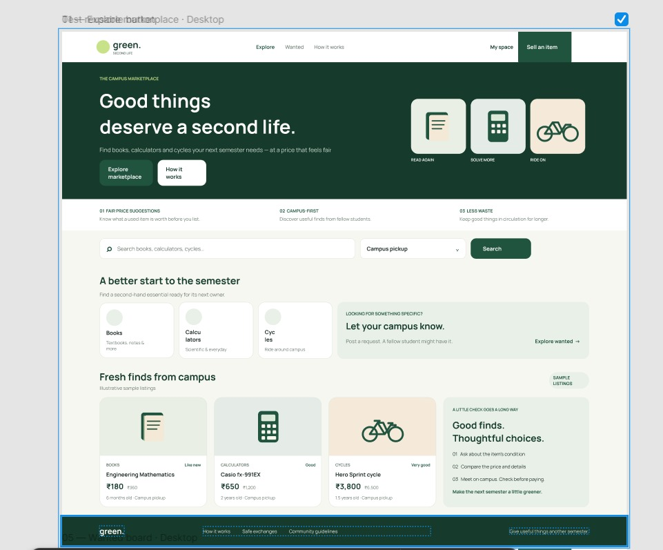
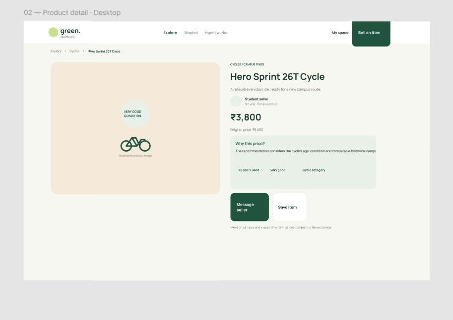
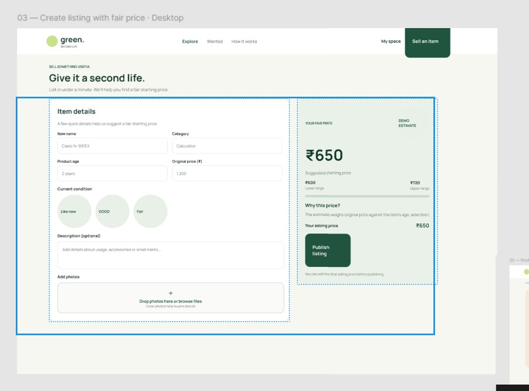
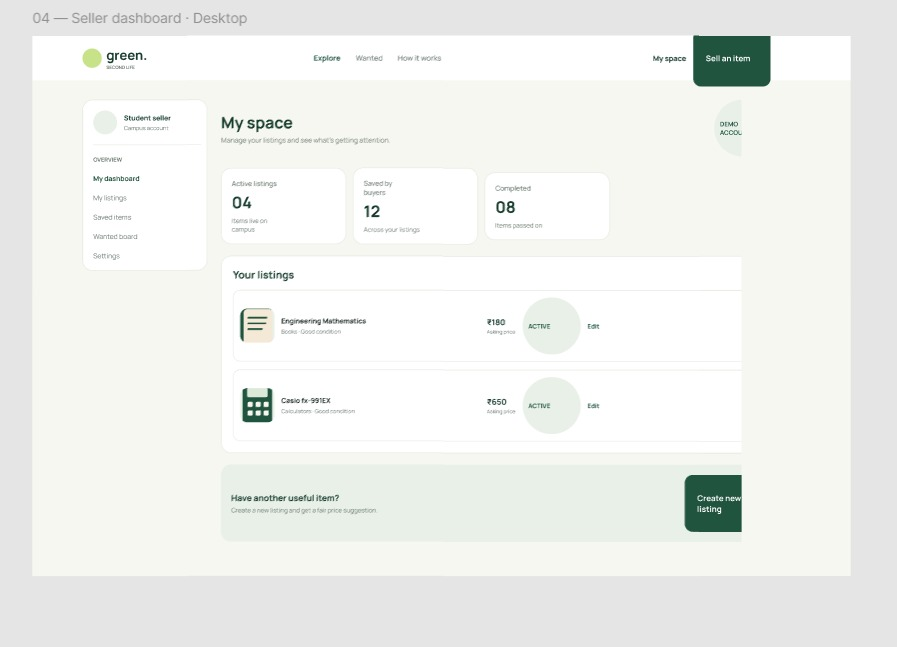
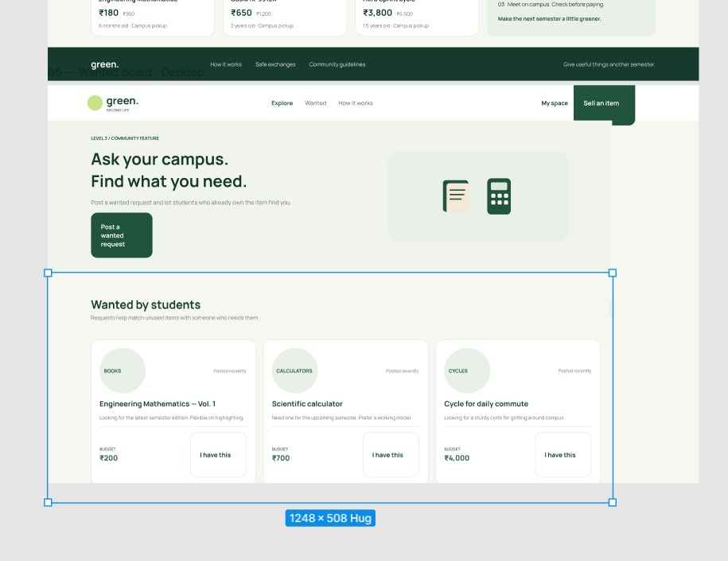
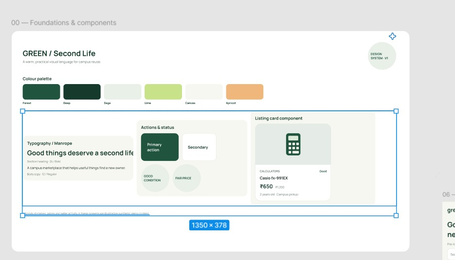

<div align="center">

# 🌿 Green — Second Life Campus Marketplace

**Give good things another go.**  
A full-stack secondhand campus marketplace with **Gemini AI real-world pricing**, **role-based dashboards** (Buyer, Seller, Admin), **chat-gated Stripe Checkout**, and a synchronized **Telegram Bot** (`@GreenSecondSellerBot`).

[](./LICENSE)
[](https://nextjs.org/)
[](https://expressjs.com/)
[](https://www.mongodb.com/)
[](https://stripe.com/)

### 🌐 Live Deployments

| Service | Platform | URL |
| :--- | :--- | :--- |
| **Web App** | Netlify | [greensecond.netlify.app](https://greensecond.netlify.app/) |
| **Backend API** | Render | [green-z5xs.onrender.com](https://green-z5xs.onrender.com/api/health) |
| **Telegram Bot** | Telegram | [@GreenSecondSellerBot](https://t.me/GreenSecondSellerBot) |

</div>

---

## ✨ Key Features

- **Separate Hero & Marketplace Pages**: Dedicated landing page (`/`), full filterable marketplace (`/explore`), product detail (`/listings/[id]`), wanted board (`/wanted`), and listing creator (`/sell`).
- **Role-Specific Dashboards**:
  - **Buyer Dashboard (`/dashboard/buyer`)**: Saved items, purchase chats & approval status, and Stripe purchase history.
  - **Seller Dashboard (`/dashboard/seller`)**: Active/completed stats, listing manager, and incoming buyer requests with **Approve / Decline** controls.
  - **Admin Dashboard (`/dashboard/admin`)**: Platform metrics, user directory, and marketplace listings overview.
- **Gemini AI Real-World Pricing + Depreciation Index**: Sellers enter an item name and click **✨ AI Price** to fetch its real-world retail price (`INR`) via Gemini Flash, automatically reduced by age and condition (`Like new`, `Good`, `Fair`).
- **Chat-Gated Stripe Checkout**: Buyers message sellers to request a purchase; once the seller approves in chat (web or Telegram), the **Buy now** Stripe Checkout button unlocks.
- **Telegram Bot (`@GreenSecondSellerBot`)**: Log in or create an account, browse available products with images, list items with Gemini pricing & photo upload, chat with buyers/sellers, and pay via Stripe directly inside Telegram.

---

## 📸 Screenshots

| Hero & Marketplace | Product Detail |
| :---: | :---: |
|  |  |

| Create Listing with AI Price | Seller Dashboard |
| :---: | :---: |
|  |  |

| Wanted Board | Design System |
| :---: | :---: |
|  |  |

---

## 🏗️ Architecture & Documentation

- 📐 **[System Architecture](docs/architecture.md)** — Mermaid diagrams, AI pricing & Stripe approval flows, and RBAC matrix
- 🔌 **[REST API Reference](docs/api.md)** — Full endpoint documentation for Auth, Listings, Chats, Payments, and Admin
- 🚀 **[Deployment Guide](docs/deployment.md)** — Production setup for **Netlify** (frontend) and **Render** (backend)

---

## ⚡ Quick Start (Local Development)

### Prerequisites
- Node.js 20+
- MongoDB Atlas URI
- Cloudinary, Stripe, Gemini API, and (optional) Telegram Bot keys

### 1. Clone the repository
```bash
git clone https://github.com/himanshugoyal2582003/Green.git
cd Green
```

### 2. Start the Backend (`http://localhost:3001`)
```bash
cd backend
npm install
cp .env.example .env   # Fill in your MongoDB, JWT, Cloudinary, Stripe, Gemini & Telegram keys
npm run dev
```

### 3. Start the Frontend (`http://localhost:3000`)
```bash
cd frontend
npm install
cp .env.example .env.local   # Set BACKEND_URL=http://localhost:3001
npm run dev
```

Open **`http://localhost:3000`** in your browser.

---

## 🤝 Contributing

Contributions are welcome! Please read [CONTRIBUTING.md](CONTRIBUTING.md) and our [Code of Conduct](CODE_OF_CONDUCT.md) before opening a pull request.

## 📄 License

This project is licensed under the **MIT License** — see the [LICENSE](LICENSE) file for details.
