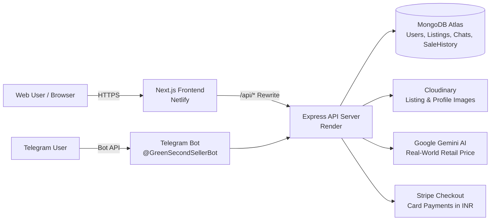
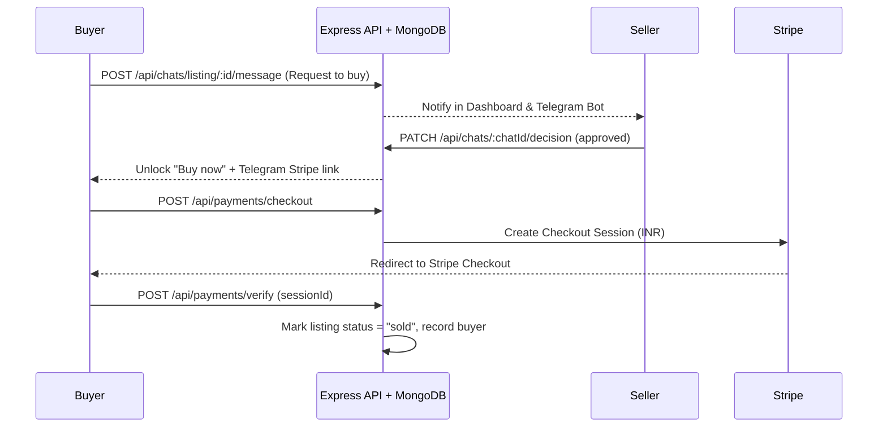

# System Architecture

Green Second Life is a full-stack campus secondhand marketplace with a Next.js App Router frontend, an Express + MongoDB backend, Gemini AI real-world price lookup, buyer–seller chat approval, Stripe Checkout, and a synchronized Telegram Bot.

---

## High-Level Architecture



---

## Core Flows

### 1. AI-Assisted Fair Pricing Flow
1. Seller enters **Item Name**, **Category**, **Condition** (`Like new`, `Good`, `Fair`), and **Age (years)** on `/sell` (or via Telegram Bot).
2. Backend calls `POST /api/listings/ai-price` → `lookupRealWorldPrice()` queries Gemini Flash (`gemini-flash-lite-latest` with fallbacks) for the real-world retail price in `INR`.
3. `suggestPrice()` applies the **depreciation index** (`category` annual depreciation rate + `condition` multiplier + historical `SaleHistory` data) to compute a fair starting price and range (`low`–`high`).

### 2. Buyer–Seller Chat & Stripe Approval Gate


---

## Repository Structure

```text
.
├── backend/
│   ├── bot/              # Telegram bot (@GreenSecondSellerBot)
│   ├── config/           # MongoDB & Cloudinary setup
│   ├── controllers/      # Route handlers (auth, listings, chats, payments, admin)
│   ├── middleware/       # JWT auth, role guard, Multer upload, error handler
│   ├── models/           # Mongoose schemas (User, Listing, ChatRequest, SaleHistory)
│   ├── routes/           # Express routers
│   ├── utils/            # Gemini pricing, depreciation index, Cloudinary, DB seeder
│   └── server.js         # Express entry point
├── frontend/
│   ├── app/              # Next.js App Router pages (/, /explore, /sell, /wanted, /listings/[id], /dashboard/*)
│   ├── components/       # Reusable UI components & AppShell
│   ├── hooks/            # useAuth, useListings, useSavedItems
│   ├── lib/              # api() fetch wrapper & shared constants
│   ├── netlify.toml      # Netlify Next.js build config
│   └── next.config.js    # /api/* rewrites to BACKEND_URL
├── docs/                 # Architecture, API, and Deployment guides
├── img/                  # UI & design system screenshots
└── render.yaml           # Render Blueprint for backend deployment
```

---

## Role-Based Access Control

| Role | Capabilities |
| :--- | :--- |
| **Buyer** | Browse/filter listings, save items, chat & request to buy, pay via Stripe after seller approval, view purchases & chats in `/dashboard/buyer`. |
| **Seller** | Everything in Buyer + publish listings with Gemini AI pricing & photos, approve/decline buyer requests, manage listings in `/dashboard/seller`. |
| **Admin** | Platform-wide overview, user directory, and all listings moderation in `/dashboard/admin` (requires `ADMIN_SIGNUP_KEY`). |
